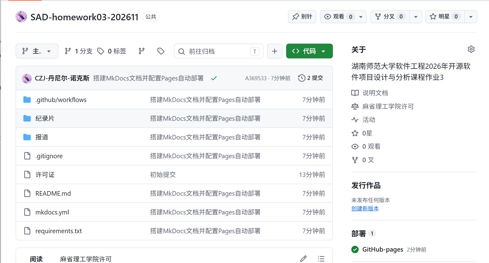
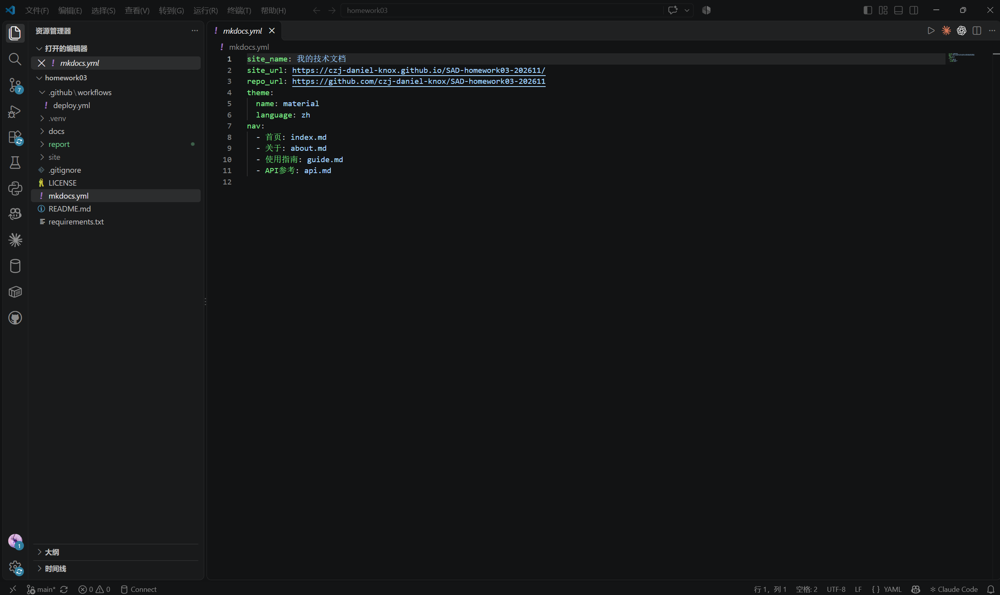
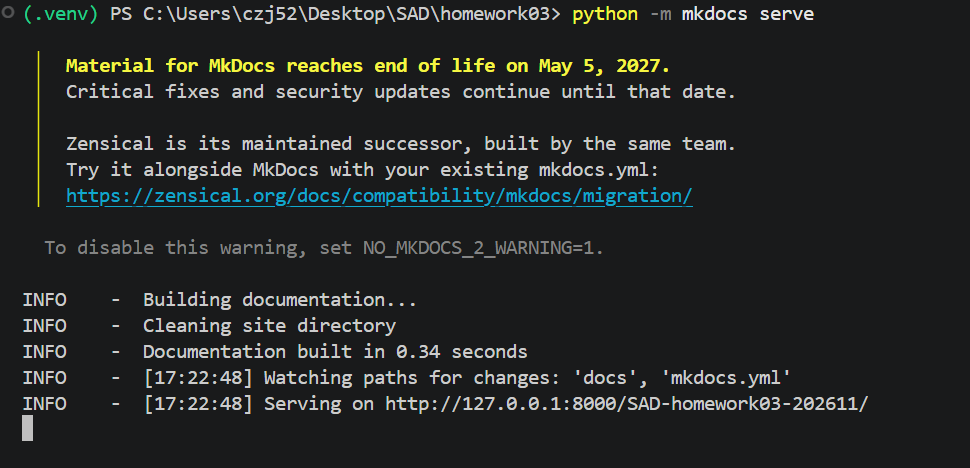
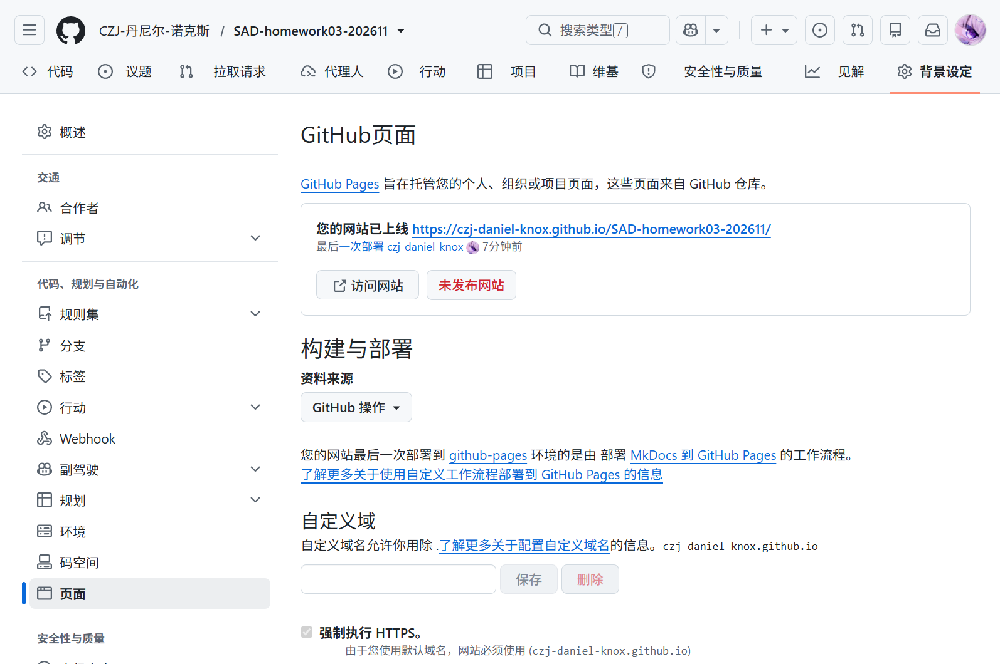
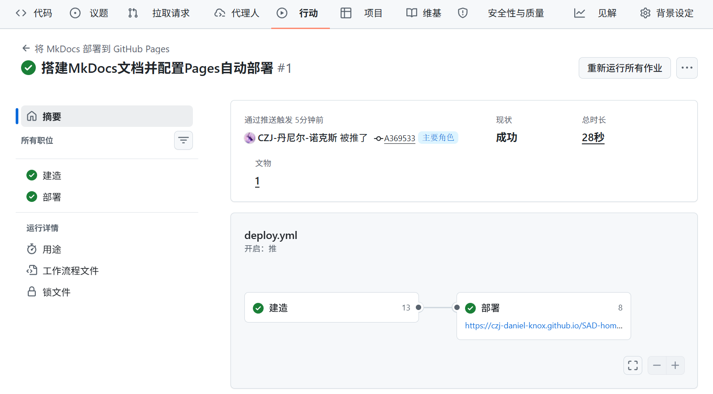
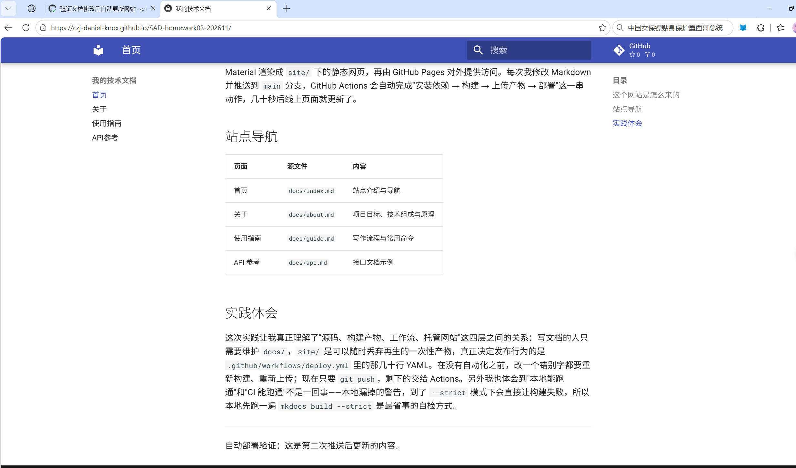
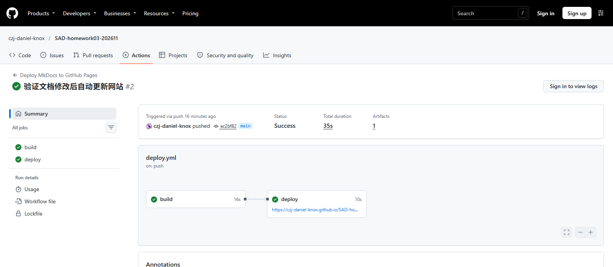

# 实践项目2：个人实验报告

## 1. 基本信息

- GitHub 登录名：czj-daniel-knox
- 个人仓库地址：<https://github.com/czj-daniel-knox/SAD-homework03-202611>
- 最终网站地址：<https://czj-daniel-knox.github.io/SAD-homework03-202611/>
- 报告入口：本文件（`report/README.md`）

## 2. 实践过程与关键截图

### 2.1 仓库创建

在 GitHub 网页点击右上角 `+` → `New repository`，Owner 选择本人账号，仓库名填 `SAD-homework03-202611`，可见性选择 **Public**，创建后确认默认分支为 `main`。之所以必须是公开仓库，是因为 GitHub Pages 对私有仓库的站点访问有额外限制，而本作业的验收要求是"公开可访问"。



### 2.2 项目结构与 MkDocs 配置

项目根目录下有三个部分：`docs/` 存放四个 Markdown 页面（网站内容来源），`report/` 存放本报告与截图，`.github/workflows/` 存放自动部署工作流。



`mkdocs.yml` 里三个关键配置的作用：

| 配置 | 值 | 作用 |
| --- | --- | --- |
| `site_name` | 我的技术文档 | 显示在站点顶部与浏览器标题 |
| `site_url` | `https://czj-daniel-knox.github.io/SAD-homework03-202611/` | 生成 sitemap 与绝对链接，必须带仓库路径与结尾斜杠 |
| `nav` | index / about / guide / api | 决定左侧导航顺序，路径相对 `docs/` |
| `theme.name` | material | 使用 Material 主题 |

`site/` 不在版本库中，它是 `mkdocs build` 生成的一次性产物，被 `.gitignore` 忽略。

### 2.3 本地构建或预览

在项目根目录创建虚拟环境并安装依赖后执行严格构建：

```bash
python -m venv .venv
.\.venv\Scripts\Activate.ps1
python -m pip install -r requirements.txt
python -m mkdocs build --strict
python -m mkdocs serve
```

`--strict` 会把所有 warning 升级为 error，因此本地通过意味着 CI 里同一条命令不会因为细节问题失败。构建通过后我用 `mkdocs serve` 在 `http://127.0.0.1:8000/SAD-homework03-202611/` 逐页检查了四件事（因为 `site_url` 带仓库路径，直接打开根路径会 302 跳转到该地址）：左侧导航四项是否都能点开、`about.md` 的表格是否正常渲染、`guide.md` 与 `api.md` 的代码块是否有语法高亮、页面间的相对链接是否跳转正确。



### 2.4 Pages 设置

进入仓库 `Settings` → `Pages` → `Build and deployment` → `Source`，选择 **GitHub Actions**。这一项决定了 Pages 不再从某个分支的目录取文件，而是接收工作流上传的产物。同时确认 `Settings` → `Actions` → `General` 允许使用 Actions。



### 2.5 Actions 首次构建和部署

推送后工作流 `Deploy MkDocs to GitHub Pages` 被 `push` 事件触发。运行记录中 `build` 与 `deploy` 两个 job 均为绿色：`build` 完成了取源码、装 Python 3.12、装依赖、`mkdocs build --strict`、上传 `site/` 产物；`deploy` 通过 `needs: build` 等构建成功后才执行，并输出 `page_url`。



- 首次部署对应的提交：<https://github.com/czj-daniel-knox/SAD-homework03-202611/commit/a369533>
- 首次部署的 Actions 运行：<https://github.com/czj-daniel-knox/SAD-homework03-202611/actions/runs/43835824938>

### 2.6 网站访问与四页导航检查

打开 `https://czj-daniel-knox.github.io/SAD-homework03-202611/`，四页导航逐一点开确认：首页正常显示站点介绍与导航表格；关于页的四层关系表与 YAML 代码块渲染正常；使用指南页的命令块与三张表格正常；API 参考页的 JSON 代码块未出现转义错误。四个页面互相之间的链接均可跳转，无 404。



### 2.7 第二次推送与自动更新验证

在 `docs/index.md` 末尾增加了一句本人编写、可辨认的文字：`自动部署验证：这是第二次推送后更新的内容。` 提交并推送到 `main`。这次**没有**点击手动部署，而是观察 `push` 是否自动触发新的运行——结果是新的运行（`event=push`，非手动）自动出现并成功，刷新网站后新增文字立即生效（用无痕窗口/带随机参数访问排除缓存干扰）。

- 第二次推送对应的提交：<https://github.com/czj-daniel-knox/SAD-homework03-202611/commit/ec2bf82>
- 第二次自动部署成功的 Actions 运行：<https://github.com/czj-daniel-knox/SAD-homework03-202611/actions/runs/43837241288>

第二次推送触发的运行记录（`event=push`，非手动触发）：



部署完成后刷新网站，首页出现新增文字"自动部署验证：这是第二次推送后更新的内容。"，其效果见 2.6 的网站截图（该截图摄于第二次部署完成之后，页面底部即可看到这句话）。


## 3. 问题与解决

| 现象 | 排查过程 | 原因 | 解决 |
| --- | --- | --- | --- |
| `mkdocs build --strict` 在本地报错 | 读终端输出的 warning 行，定位到具体文件与行号 | 新增页面的相对链接写成了 `docs/xxx.md` | 改为相对 `docs/` 的 `xxx.md` 后重新构建通过 |
| 提交前 `git status` 中出现大量未跟踪文件 | `git status` 逐条查看 | 虚拟环境与 `site/` 未被忽略 | 补充 `.gitignore` 后再 `git add`，确认暂存区只有源码、配置与报告 |
| （若有 Actions 报错，在此记录：失败步骤、日志关键行、修复方式） | | | |

如果部署过程中没有出现失败，说明核对过以下内容：`build` 步骤的完整日志无 warning；`deploy` 步骤输出的 `page_url` 与 `Settings` → `Pages` 显示的地址一致；`.gitignore` 生效，`site/` 与 `.venv/` 均未进入版本库。

## 4. 原理理解

**1. `docs/` 和 `site/` 各保存什么？为什么不用手工修改 `site/`？**

`docs/` 保存的是 Markdown 源码，是唯一需要人维护的内容；`site/` 保存的是 `mkdocs build` 把 Markdown 加主题模板渲染出来的成品 HTML、CSS、JS 与静态资源。`site/` 是派生数据，每次构建都会被整体重新生成，手工修改会在下一次构建时被覆盖；它也不进版本库，别人 clone 下来并不存在这个目录，改动无法共享。所以正确做法是只改 `docs/`，让构建流程负责生成 `site/`。

**2. 本次工作流在什么情况下自动运行？**

只在两种情况下运行：一是向 `main` 分支推送，且改动涉及 `docs/**`、`mkdocs.yml`、`requirements.txt` 或 `.github/workflows/deploy.yml` 之一；二是在 Actions 页面手动点击 `Run workflow`（`workflow_dispatch`）。推送其他路径（例如只改 `report/`）不会触发。

**3. `build` 与 `deploy` 两个任务有什么区别？**

`build` 运行在普通 runner 上，负责把源码变成产物：检出代码、安装 Python 3.12 与依赖、执行 `mkdocs build --strict`、用 `upload-pages-artifact` 把 `site/` 打包成 Pages 专用的 artifact。`deploy` 通过 `needs: build` 依赖前者，只在构建成功后运行，使用 `deploy-pages` 把 artifact 真正发布到 `github-pages` 环境，并输出站点 URL。前者可以重复执行而不影响线上，后者才会改变线上内容，因此把权限（`pages: write`、`id-token: write`）只授予 `deploy` 任务，符合最小权限原则。

**4. 只修改 `report/README.md` 会触发部署吗？为什么？**

不会。工作流的 `on.push.paths` 只列了 `docs/**`、`mkdocs.yml`、`requirements.txt` 和 `.github/workflows/deploy.yml`，`report/` 不在其中，因此这次 push 不会创建运行记录。这样设计是合理的：报告不是网站内容，改了它没必要重新构建和发布站点，也避免了无意义的部署次数。

**5. 本次方案为何无需创建 `gh-pages` 分支？**

因为发布方式改成了"产物上传"模型：`upload-pages-artifact` 把 `site/` 打包成 artifact，`deploy-pages` 直接把该 artifact 发布出去，Pages 的发布源设为 `GitHub Actions`，整个链路不经过任何分支的提交。传统方案需要把构建结果推到 `gh-pages` 分支再从该分支发布，才会有额外的分支、权限和 PR 要求；本方案没有这一步，自然也不需要创建分支或配置令牌。

## 5. 附：提交记录

| 用途 | 链接 |
| --- | --- |
| 首次搭建并部署 | <https://github.com/czj-daniel-knox/SAD-homework03-202611/commit/a369533> |
| 二次修改验证自动更新 | <https://github.com/czj-daniel-knox/SAD-homework03-202611/commit/ec2bf82> |
| 补充报告 | <https://github.com/czj-daniel-knox/SAD-homework03-202611/commit/51410fa> |
